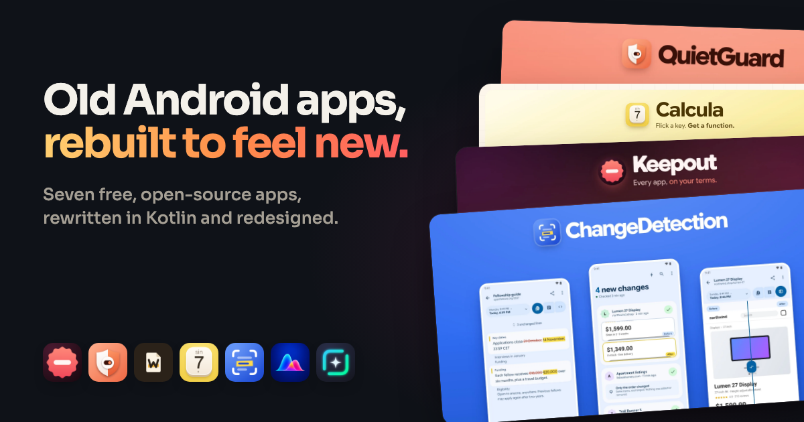

<div align="center">
  <a href="https://kotlin-reforge.vercel.app">
    
  </a>
</div>

<div align="center">
  <strong><a href="https://kotlin-reforge.vercel.app">Live Preview</a></strong>
</div>

<br>

# Kotlin Reforge

**Old Android apps, rebuilt to feel new.**

The website for seven free, open-source apps, rewritten in Kotlin and redesigned screen by screen. Each app lives in its own repository; this one is only the site.

| App                                                                | What it does                            | Rebuilt from           |
| ------------------------------------------------------------------ | --------------------------------------- | ---------------------- |
| [Keepout](https://github.com/bernaferrari/rethink-app)             | Firewall, encrypted DNS and VPN         | Rethink DNS + Firewall |
| [QuietGuard](https://github.com/bernaferrari/QuietGuard)           | Decide which apps reach the internet    | NetGuard               |
| [Wordkeep](https://github.com/bernaferrari/markor)                 | Markdown notes kept as plain files      | Markor                 |
| [Calcula](https://github.com/bernaferrari/calcula)                 | Calculator with functions a flick away  | Calculator++           |
| [ChangeDetection](https://github.com/bernaferrari/ChangeDetection) | Alerts when a web page changes          | Its own 2018 app       |
| [WiFi Weakspot](https://github.com/bernaferrari/wifi-weakspot)     | See where your Wi-Fi gets weak          | New app                |
| Lumina                                                             | Remote desktop for Omarchy and Hyprland | New app                |

For developers, the site also features two Kotlin Multiplatform libraries: [KMPwright](https://github.com/bernaferrari/kmpwright), browser automation for Android, iOS and JVM, and [Diagonal Wipe Icon](https://github.com/bernaferrari/diagonal-wipe-icon).

App details and screenshots live in [`lib/apps.ts`](lib/apps.ts) and `public/<app>/`. The screenshots are each app's README images, converted to WebP.

### Quick Start

```shell
pnpm install
pnpm dev
```

Available at `http://localhost:3000`.

### Deploy

```shell
pnpm build
pnpm start
```
