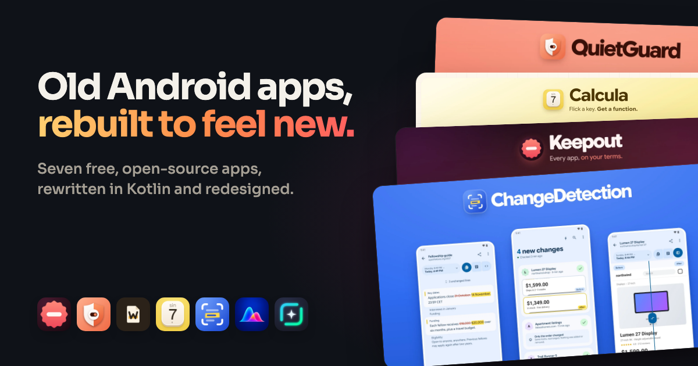

<div align="center">
  <a href="https://kotlin-reforge.vercel.app">
    
  </a>
</div>

<div align="center">
  <strong><a href="https://kotlin-reforge.vercel.app">Live Preview</a></strong>
</div>

<br>

# Kotlin Reforge

**Old Android apps, rebuilt to feel new.**

The website for seven free, open-source apps, rewritten in Kotlin and redesigned screen by screen. Each app lives in its own repository; this one is only the site.

| App                                                                | What it does                            | Rebuilt from           |
| ------------------------------------------------------------------ | --------------------------------------- | ---------------------- |
| [Keepout](https://github.com/bernaferrari/rethink-app)             | Firewall, encrypted DNS and VPN         | Rethink DNS + Firewall |
| [QuietGuard](https://github.com/bernaferrari/QuietGuard)           | Decide which apps reach the internet    | NetGuard               |
| [Wordkeep](https://github.com/bernaferrari/markor)                 | Markdown notes kept as plain files      | Markor                 |
| [Calcula](https://github.com/bernaferrari/calcula)                 | Calculator with functions a flick away  | Calculator++           |
| [ChangeDetection](https://github.com/bernaferrari/ChangeDetection) | Alerts when a web page changes          | Its own 2018 app       |
| [WiFi Weakspot](https://github.com/bernaferrari/wifi-weakspot)     | See where your Wi-Fi gets weak          | New app                |
| Lumina                                                             | Remote desktop for Omarchy and Hyprland | New app                |

For developers, the site also features two Kotlin Multiplatform libraries, [KMPwright](https://github.com/bernaferrari/kmpwright), browser automation for Android, iOS and JVM, and [Diagonal Wipe Icon](https://github.com/bernaferrari/diagonal-wipe-icon), and [Screenshot Studio](https://github.com/bernaferrari/screenshot-studio), which makes every app's store and README art from real captures.

App details and screenshots live in [`lib/apps.ts`](lib/apps.ts) and `public/<app>/`. The screenshots are each app's README images, converted to WebP.

### Refresh app images

The asset map in [`scripts/asset-sources.json`](scripts/asset-sources.json) points to each app's icon and README artwork. By default the scripts look for checkouts under `~/Documents/android`; set `ANDROID_PROJECTS_DIR` to use another folder.

```shell
pnpm assets:check                 # report source and site image changes across all apps
pnpm assets:check calcula         # check one app
pnpm assets:sync calcula          # convert its current README art to WebP and copy its icon
```

When an icon or screenshot changes, first regenerate that app's README artwork using its own Screenshot Studio workflow, then run the sync command. The sync reads the working tree, including uncommitted changes. Review and commit the source artwork in its app repository as well as the site images.

[`scripts/asset-hashes.json`](scripts/asset-hashes.json) records SHA-256 hashes of both the source and site files. A check reports missing files, changed sources, and site images edited since the last sync. Entries marked `baseline` record the files that already existed when tracking was introduced; they do not assert that the old site image was generated from the current source. Sync an app to establish verified generated entries. The check requires the app checkouts and is separate from the site build.

### Quick Start

```shell
pnpm install
pnpm dev
```

Available at `http://localhost:3000`.

### Deploy

```shell
pnpm build
pnpm start
```
